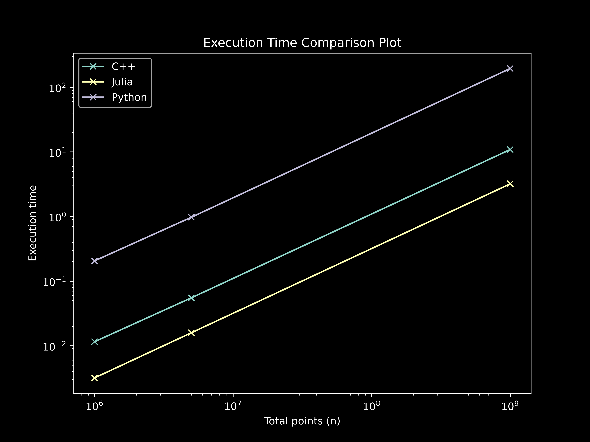

# Monte Carlo Pi Approximations

# Aim

Compare the execution speeds between `python`, `C++`, and `Julia` by approximation $\pi$ using a standard monte carlo simulation.

# Files
- `python_mc_pi.py`: python script
- `cpp_mc_pi.cpp`: C++ script
- `cpp_mc_pi`: compiled c++ code
- `julia_mc_pi.jl`: julia script
- `ABC_log.txt`: the run output for each language
- `README.md`: this file

# Dependencies

| Language | Python (3.14.6) | C++ (clang++ 21.0.0) | Julia (1.12.6) |
| :--- | :--- | :--- | :--- |
| Random Point Generator | `random` | `random`| `rand()` |
| Time keeping | `time` | `std::chrono::high_resolution_clock` | Benchmarktools `@btime` |

And, of course, you need to have all three languages installed to be able to run the code.

# Results

Exact results can be seen in the respective `<lang>_log.txt` files.

### Notes on the execution

A script (`execution`) was created to automatically execute all codes for all sample sizes. Before benchmarking, the Python script was run with a virtual enviroment as well as with a system-wide python installation, with no substantial difference in execution time (especially, given the absolute values of Python). As standard for benchmarking and optimisation, the C++ script was compiled using the `g++ -O3` flag for the high optimisation level, and the Julia scripts first runs the `estimate_pi` function without time-keeping (for JIT) and then (once it's compiled) it benchmarks the execution. 

# Conclusions

As expected, python is by far the slower programming language. Surprisingly Julia is about ABCDEFGHI faster than C++. Although both are in the same order of magnitude, espeically compared to python.

Also note-worthy is the fact, that the execution time grew linearly for all languages (in a logarthmic scale).
