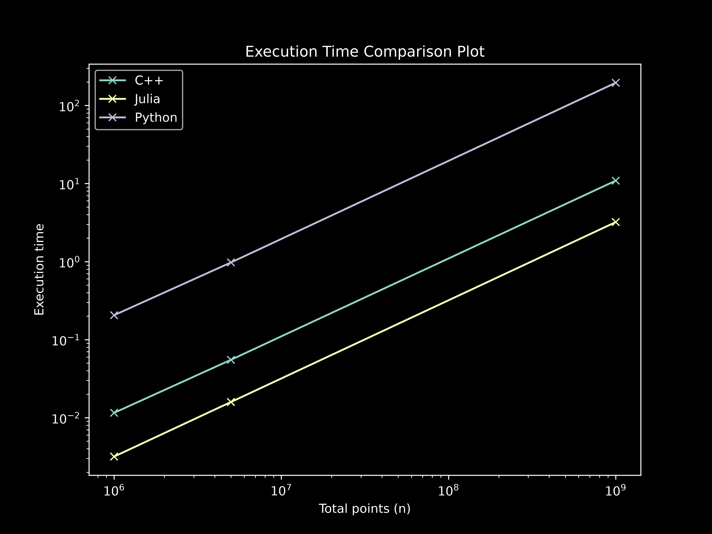
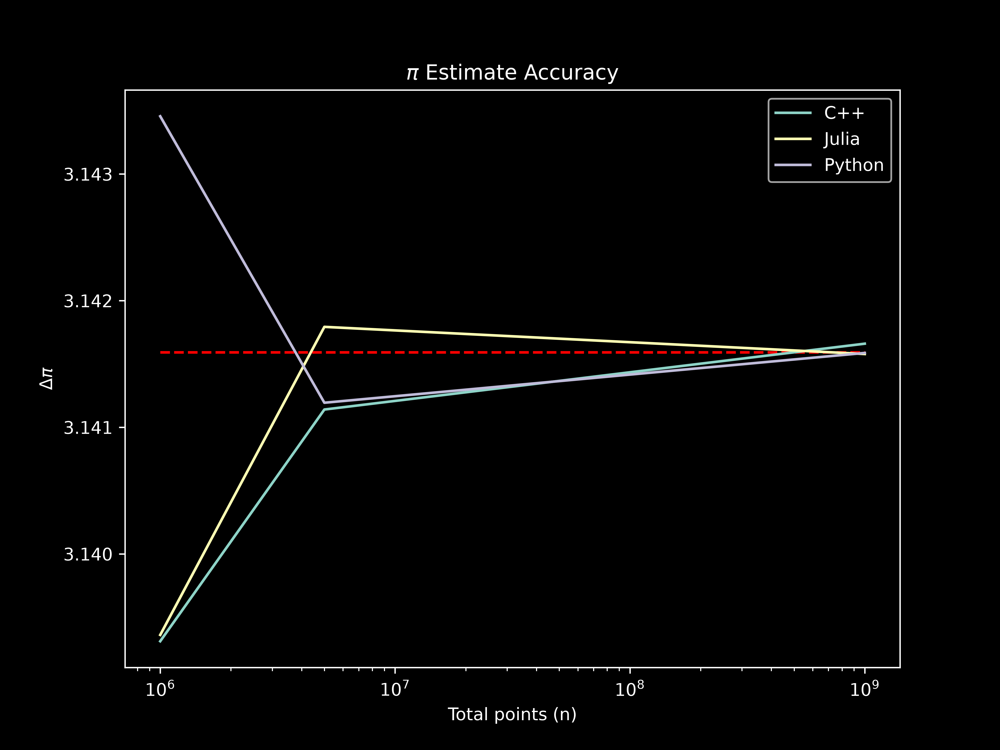

# Monte Carlo Pi Approximations

## Aim

Compare the execution speeds between Python, C++ and Julia by approximating $\pi$ using a standard monte carlo algorithm.

**Read the full blogpost [here](https://joanalnu.pages.dev/ideas/monte-carlo-pi-approximaations).**

## Files

The dir is divided into sub-dirs for each of the three languages (`cpp`, `julia`, `python`). Inside each sub-dir there is a code file (`.cpp`, `.jl`, `.py`) and a log file (`*log.txt`).

In the `cpp` folder there is also the compiled C++ script.

**Additional files**
- `README.md`: this file
- `calculando_pi_edu.ipynb`: educational notebook
- `execution`: the benchmarking automation script

## Implementation 

|Language|Python 3.12 |C++ (g++ 13.3) | Julia 1.12|
|---|---|---|---|
|Random Generator| `numpy.random.random`|`std::mt19937` (`<random>`)|`rand()`|
|Execution Paradigm| vectorised batching |Native Scalar loop with `-O3` |JIT Compilation Loop|
|Time Measurement|`time.perf_counter`|`high_resolution_clock`|`@btime` (BenchmarkTools)|

### Notes on the execution

A script (`execution`) was created to automatically execute all codes for all sample sizes. Before benchmarking, the Python script was run with a virtual enviroment as well as with a system-wide python installation, with no substantial difference in execution time (especially, given the absolute values of Python). As standard for benchmarking and optimisation, the C++ script was compiled using the `g++ -O3` flag for the high optimisation level, and the Julia scripts first runs the `estimate_pi` function without time-keeping (for JIT) and then (once it's compiled) it benchmarks the execution. 

## Results

### Execution Time

Exact results can be seen in the respective `<lang>_log.txt` files.

### Accuracy

A plot, visually showing how the accurave improves for the 3 tested point sample sizes.

# Conclusions

As expected, python is by far the slower programming language. After vectorising and batching the loop with NumPy it performed much better (about 2x faster), but still much slower than the other languages. Surprisingly Julia is faster than C++, although both are in the same order of magnitude.

Also note-worthy is the fact, that the execution time grew linearly for all languages (in a logarthmic scale).

